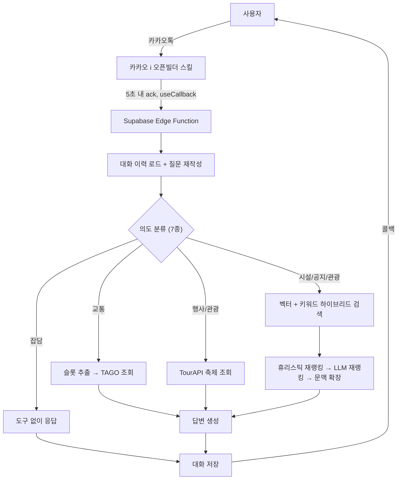

# 동해시시설관리공단 카카오톡 챗봇

동해시시설관리공단의 시설(수영장, 캠핑장 등) 이용 문의에 응대하는 카카오톡 상담 봇입니다. 사이드 프로젝트 데모가 아니라 실제 채널에서 시민 문의를 받고 있는 프로덕션 서비스입니다.

- 채널: [카카오톡 채널 바로가기](http://pf.kakao.com/_ZLGwX)
- 인프라: Supabase Edge Functions (Deno) 단일 함수로 배포, 서버 상시 운영 없음

## Overview

공단 문의는 성격이 서로 다른 유형(공지 검색, 실시간 교통 조회, 관광 추천, 잡담)이 섞여 들어오는데, 하나의 프롬프트·검색 전략으로 전부 처리하면 어느 쪽도 품질이 떨어졌습니다. 이 프로젝트는 매 발화마다 경량 LLM이 먼저 의도를 분류하고, 의도별로 별도의 검색 전략·외부 API 호출·답변 규칙을 실행하는 구조로 이 문제를 풀었습니다.

| 입력 | 처리 경로 |
|---|---|
| "수영교실 언제 접수해요?" | 공단 공지 문서 하이브리드 검색 (RAG) |
| "내일 서울 가는 기차 몇 시야?" | 국토교통부 TAGO 실시간 열차 조회 |
| "주말에 여행 코스 추천해줘" | 관광 POI + 진행 중 축제 기반 추천 |
| "ㅎㅇ" | 검색·도구 호출 없이 즉시 응답 |

## Architecture



카카오 스킬 서버는 응답이 5초를 넘으면 타임아웃 처리하는데, RAG와 다단계 LLM 호출을 거치는 답변 생성은 그보다 오래 걸립니다. 이를 위해 요청을 받는 즉시 `useCallback` 플래그로 먼저 응답을 반환하고, 실제 처리는 `EdgeRuntime.waitUntil()`로 응답 이후에도 유지되는 백그라운드 태스크에서 진행한 뒤, 완료 시 카카오가 제공한 콜백 URL로 답을 다시 전송합니다.

**요청 처리 단계**
1. 최근 대화(최대 12행)를 불러와 시점 라벨("N일 전 대화")을 붙이고, 마지막 발화를 독립적인 검색 질문으로 재작성
2. 경량 모델이 임베딩·키워드 추출과 함께 발화를 7종 의도(잡담/교통/행사/관광/시설/공지/일반)로 분류 — 이후 모든 경로를 이 결과가 결정
3. 의도에 따라 분기: 교통은 슬롯 추출 후 TAGO 조회(필수 슬롯 누락 시 되묻기), 행사·관광은 TourAPI 축제 조회 — 문서 검색과 병렬 실행
4. 벡터 검색과 키워드별 개별 쿼리 결과를 병합해 후보를 만들고, 재랭킹 후 상위 문서의 형제 청크까지 확장해 문맥 구성
5. 의도별 규칙(행정=누락 없이 종합, 관광=조건에 맞게 추림)을 적용해 답변 생성, 유출 가드 통과 후 카카오 콜백 전송

## Retrieval Design

문서는 Supabase Postgres에 `pgvector`(1536차원)로 저장돼 있고, 검색은 벡터 유사도만으로 처리하지 않습니다.

- **하이브리드 검색**: 벡터 검색과 추출된 키워드별 개별 쿼리를 병렬로 실행해 병합합니다. 키워드를 OR로 묶어 한 번에 조회하면 "운영시간"처럼 흔한 키워드가 결과를 독식해 시설명 같은 희귀 키워드가 밀려나는 문제가 있어, 키워드마다 별도 쿼리로 각자의 상위 매칭을 보장합니다.
- **재랭킹**: 공지 문서는 매년 비슷한 내용이 갱신되는데 유사도만으로는 연도 구분이 안 됩니다. 게시일 기반 가중치(휴리스틱)에 더해, LLM이 오늘 날짜를 기준으로 후보 문서를 다시 골라내는 2차 재랭킹을 거칩니다. 상시 정보(시설 안내)는 게시일이 없어 별도 가중치를 둡니다.
- **문서 다양화 + 문맥 확장**: 재랭킹 후보에 문서당 청크 수 상한을 둬 청크가 많은 문서 하나가 문맥을 독점하지 않게 하고, 최종 선택된 상위 문서는 형제 청크까지 전부 포함시켜 정답이 다른 청크에 걸쳐 있는 경우를 보완합니다.

## Data Pipeline

크롤링 데이터(JSONL)를 임베딩까지 적재하는 배치 스크립트가 검색 품질에 실제로 기여하는 부분입니다.

- **표 정규화**: 크롤러가 받아온 마크다운 표는 병합 셀(rowspan/colspan)이 풀려 행이 쪼개지거나, 열 방향 표(구분 + 속성)가 그대로 들어오는 경우가 많아 LLM이 잘 읽지 못했습니다. 표 형태를 감지해 "- 프로그램명: 요가 주간 | 시간: 10:00" 같은 레코드 문장으로 변환하는 전처리를 거칩니다.
- **청크 분할**: 500자 단위로 자르되 줄 중간에서 끊지 않아 표에서 변환된 레코드 한 줄이 반토막 나지 않게 합니다.
- **제목/게시일 헤더 삽입**: 각 청크를 임베딩하기 전에 문서 제목과 게시일을 헤더로 붙여, 제목 기반 검색 정확도를 높이고 재랭킹 단계에서 LLM이 게시 시점을 판단할 수 있게 합니다.
- **재실행 가능한 적재**: 임베딩 API 호출은 배치·재시도·지수 백오프로 처리하고, 중단 시 마지막 처리 지점부터 이어받을 수 있습니다(`RESUME_FROM`). 임베딩만 별도로 채우는 백필 스크립트(`embed_backfill.js`)도 분리해 뒀습니다.
- **관광 데이터**: 한국관광공사 TourAPI에서 동해시 관광지·문화시설·레포츠·숙박·음식점 POI를 지역 코드로 조회해 적재하며, 재실행 시 기존 `tour` 문서를 지우고 다시 채우는 멱등 방식입니다.

## Reliability & Safety

- **프롬프트 유출 방어**: 시스템 프롬프트 자체에 유출 거부 규칙을 넣는 것과 별개로, 답변을 카카오로 보내기 직전 프롬프트 특유의 문구가 응답에 섞여 있는지 한 번 더 검사해 걸러내는 2차 안전망을 둡니다.
- **근거 없는 응답 억제**: 시스템 프롬프트에서 자료에 없는 정보는 지어내지 말고 담당 기관 문의를 안내하도록 명시합니다.
- **교통 슬롯 미확정 시 추측 금지**: 출발지·도착지 중 하나라도 대화에서 확인되지 않으면 임의로 추정하지 않고 되묻습니다.
- **링크 무결성**: 예약 링크와 시설 안내 페이지 링크를 구분해서 제공하며, 크롤러가 놓친 실제 예약 사이트 주소는 원본 페이지를 재조회해 별도로 보강합니다(`patch_reserve_links.js`).

## Operations

Supabase 무료 플랜은 일정 기간 API 요청이 없으면 프로젝트를 자동으로 일시정지합니다. GitHub Actions로 3일마다 가벼운 헬스체크 요청을 보내 이를 방지합니다(`.github/workflows/keep-alive.yml`).

## Tech Stack

| 영역 | 사용 기술 |
|---|---|
| 실행 환경 | Supabase Edge Functions (Deno) |
| 저장소 | Supabase Postgres + `pgvector`, 대화 기록 테이블 |
| LLM | OpenAI 호환 게이트웨이 (답변 생성·재랭킹·의도 분류·질문 재작성) |
| 임베딩 | OpenAI `text-embedding-3-small` (1536차원) |
| 외부 API | 국토교통부 TAGO(고속버스·열차), 한국관광공사 TourAPI(관광 POI·축제) |
| 채널 연동 | 카카오 i 오픈빌더 (스킬 서버 + 콜백) |
| CI/운영 | GitHub Actions (헬스체크) |

## Dataset Size

문서 5,758청크 (공지 4,233 · 시설 안내 94 · 공단 소개 페이지 1,368 · 관광 POI 63청크/46곳)

## Project Structure

```
supabase/functions/kakao-bot/index.ts   # 의도 분류·도구 호출·검색·답변 생성을 담당하는 본체
ingest.js                               # 공단 문서 파싱 → 표 정규화 → 청크 → 임베딩 → 적재
ingest_tour.js                          # TourAPI 관광 POI 적재
table_utils.js                          # 마크다운 표 → 레코드 문장 변환
patch_reserve_links.js                  # 원본 페이지에서 예약 링크 재조회·주입
embed_backfill.js                       # 임베딩 누락분 백필
check_db.js / check_supabase.js         # 적재 결과 / DB 연결·RLS 검증
check_gateway.js                        # LLM 게이트웨이(키·모델) 헬스체크
check_conv.mjs                          # 최근 대화 로그 조회
set_secrets.js                          # .env → Supabase Edge Function 시크릿 동기화
```

크롤링 원본 데이터, 실제 발급받은 키, 내부 테스트 스위트는 개인정보·운영 보안 문제로 저장소에서 제외했습니다 (`.gitignore` 참고). 아래 실행 방법은 구조를 재현하기 위한 안내이며, 동작시키려면 각자 데이터와 키가 필요합니다.

## Setup

```bash
npm install
cp .env.example .env   # Supabase 키, LLM 게이트웨이 키, 임베딩용 OpenAI 키, TAGO/TourAPI 키 입력
```

```bash
# 1. 데이터 적재
node ingest.js
node ingest_tour.js
node check_db.js

# 2. Edge Function 배포
node set_secrets.js
npx supabase functions deploy kakao-bot --project-ref <project-ref>

# 3. 상태 점검
node check_supabase.js
node check_gateway.js
```

배포된 함수 URL(`https://<project-ref>.supabase.co/functions/v1/kakao-bot`)을 카카오 i 오픈빌더 스킬 서버 주소로 등록하면 연동이 끝납니다.

## Known Limitations

- 답변 생성 모델은 별도 파인튜닝 없이 범용 LLM 게이트웨이를 그대로 사용 — 비용·지연 절감을 위한 오픈소스 sLLM 전환을 검토 중입니다.
- 재랭킹·의도 분류가 모두 LLM 호출에 의존해, 게이트웨이 장애 시 검색 품질이 아니라 응답 자체가 영향을 받습니다.
- 표 정규화 로직은 실제로 수집된 크롤링 표 패턴에 맞춰 튜닝돼 있어, 크롤러가 바뀌면 재검증이 필요합니다.

## License

MIT
