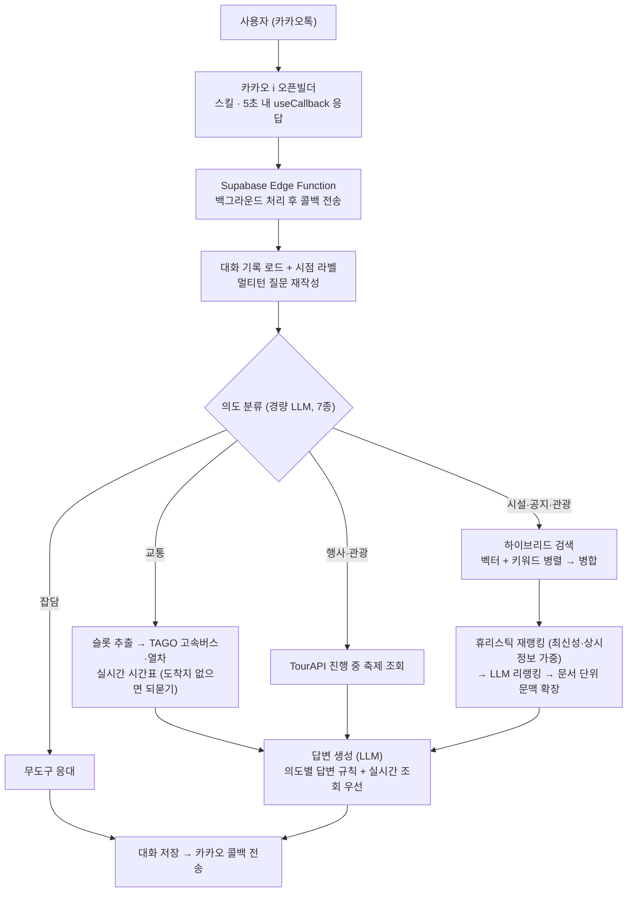

# 동해시시설관리공단 AI 챗봇

**의도 기반 도구 라우팅(intent-driven tool routing)으로 동작하는 카카오톡 에이전트.**
사용자의 질문 의도를 경량 LLM이 분류하고, 질문마다 가장 적합한 경로 — 내부 문서 RAG, 실시간 교통·축제 API, 관광 추천, 무도구 응대 — 하나를 골라 답합니다.

동해시시설관리공단과 협업해 개발했으며, 데모가 아니라 **실제 카카오톡 채널에서 운영 중인 서비스**입니다.
👉 [카카오톡 채널에서 사용해보기](http://pf.kakao.com/_ZLGwX)

```
"수영교실 언제 접수해요?"        → 공단 공지 하이브리드 RAG
"내일 서울 가는 기차 몇 시야?"    → 열차 실시간 시간표 조회 (오늘 기준 운행·요금)
"주말에 여행 코스 추천해줘"       → 관광 POI + 진행 중 축제 기반 맞춤 추천
"ㅎㅇ"                          → 검색 없이 가벼운 응대
```

## Features

**🧭 의도 라우팅 (7종)**
경량 모델이 발화를 잡담 / 교통 / 행사 / 관광 / 시설 / 공지 / 일반으로 분류하고, 의도에 따라 검색 전략·도구·답변 규칙이 전부 달라집니다. 무거운 모델이 매 턴 도구를 고르는 대신 소형 분류기가 관문이 되어 비용과 지연을 줄입니다.

**📚 하이브리드 RAG (공단 문서 약 5,800청크)**
벡터 검색(pgvector) + LLM 추출 키워드별 개별 쿼리를 병렬 실행해 병합. 게시일 기반 최신성 가중, 상시 정보(시설 안내) 별도 보정, 문서당 청크 다양화, LLM 리랭킹, 상위 문서 전체 청크 확장까지 — "20년치 공지에서 최신 공지를 근거로" 답하기 위한 다층 설계입니다.

**🔧 실시간 도구 호출**
시간이 지나면 부패하는 정보는 문서가 아니라 API를 호출해 답합니다.
- 고속버스·열차 시간표/요금 (국토교통부 TAGO) — 질문에서 수단·출발지·도착지·날짜를 자동 추출("내일" 해석 포함)하고, **도착지가 없으면 추측하지 않고 되묻습니다**
- 진행·예정 축제·행사 (한국관광공사 TourAPI) — 조회 시점 기준, 종료 행사 자동 필터

**💬 멀티턴 대화**
대명사 질문("거기 몇 명 모집해요?")은 검색 전에 독립 질문으로 재작성. 대화 기록에는 시점 라벨("N일 전 대화")을 붙여 옛 주제가 새 질문에 끌려 나오는 것을 막고, 되묻기 뒤엔 "동서울" 한 마디만 답해도 완전한 질문으로 복원됩니다.

**🗺️ 관광 안내 모드**
관광공사 POI(관광지·맛집·숙박 49곳)를 기반으로, 대화에서 파악한 조건(인원·기간·분위기)에 맞춰 2~5곳을 추려 추천. "더 여유롭게" 같은 수정 요청엔 일정을 실제로 바꿉니다. 관광 가중치는 관광 의도에만 적용되어 행정 질문 품질을 침범하지 않습니다.

**🛡️ 신뢰 장치**
- 시스템 프롬프트 유출 이중 방어 (프롬프트 규칙 + 전송 직전 유출 마커 감지 차단)
- 링크는 원본 페이지에서 검증된 주소만 사용 — 예약 링크와 안내 페이지를 구분해 제공
- 근거 없는 답변 생성 억제: 데이터에 없는 상호·장소는 지어내지 않고 문의처 안내

## Architecture Overview



**파이프라인 단계**

1. **대화 맥락**: 사용자별 대화 기록을 불러와 시점 라벨을 붙이고, 마지막 발화를 독립 질문으로 재작성 (인사말은 통과)
2. **의도 분류**: 경량 모델이 7종 의도로 분류 — 이 결과가 이후 모든 경로를 결정
3. **도구 라우팅**: 교통 → 슬롯 추출 후 TAGO 실시간 조회(필수 정보 누락 시 되묻기), 행사·관광 → TourAPI 축제 조회. 도구는 문서 검색과 병렬 실행
4. **하이브리드 검색**: 벡터 + 키워드별 개별 쿼리 병합 → 최신성/상시정보 가중 → LLM 리랭킹 → 상위 문서 전체 청크 확장
5. **답변 생성**: 의도별 규칙(행정=빠짐없이, 관광=조건 맞춰 추리기)으로 생성, 실시간 조회 결과 우선. 유출 가드 통과 후 카카오 콜백 전송

## Tech Stack

| 구성 | 기술 |
|---|---|
| 런타임 | Supabase Edge Functions (Deno) — 서버리스, 콜백 기반 비동기 응답 |
| 데이터베이스 | Supabase Postgres + pgvector (1536차원) · 대화 기록 테이블 |
| LLM | OpenAI 호환 게이트웨이 (답변·리랭킹 / 분류·재작성·추출 2단 모델) → 오픈소스 sLLM 전환 예정 |
| 임베딩 | text-embedding-3-small |
| 외부 도구 | 국토교통부 TAGO (고속버스·열차) · 한국관광공사 TourAPI (관광 POI·축제) |
| 채널 | 카카오 i 오픈빌더 (스킬 + 콜백) |

## Repository Layout

```
supabase/functions/kakao-bot/   # 에이전트 본체: 의도 라우팅 · 도구 호출 · 하이브리드 RAG · 콜백
ingest.js                       # 공단 문서 적재 (파싱 → 표 변환 → 청크 → 임베딩)
ingest_tour.js                  # TourAPI 관광 POI 적재
patch_reserve_links.js          # 예약 링크 원본 검증·주입
table_utils.js                  # 크롤링 표 → 레코드 문장 변환
embed_backfill.js / check_db.js # 임베딩 백필 · 적재 검증
check_supabase.js               # Supabase 연결·RLS 상태 점검
check_gateway.js                # LLM 게이트웨이(모델·키) 상태 점검
check_conv.mjs                  # 최근 대화 로그 조회
set_secrets.js                  # .env → Supabase Edge Function 시크릿 일괄 등록
```

> 원본 크롤링 데이터(개인정보 포함)와 실제 API 키, 내부 테스트 스위트는 보안상 저장소에 포함하지 않습니다 (`.gitignore` 참고).
> 아래 실행 방법은 구조를 재현하기 위한 가이드이며, 동작을 위해서는 각자 발급받은 키와 데이터가 필요합니다.

## Getting Started

### 요구 사항
- Node.js 18+
- [Supabase](https://supabase.com) 프로젝트 (Postgres + `pgvector` 확장)
- [Supabase CLI](https://supabase.com/docs/guides/cli) (`npx supabase`)
- OpenAI 호환 게이트웨이 키(답변 생성용) · OpenAI 키(임베딩용) · [공공데이터포털](https://www.data.go.kr) TAGO/TourAPI 키
- 카카오 i 오픈빌더 채널 (스킬 연동용)

### 환경 변수
`.env.example`을 복사해 `.env`를 만들고 값을 채웁니다.
```bash
cp .env.example .env
```

### 설치
```bash
npm install
```

### 문서 적재 (RAG)
```bash
node ingest.js          # 크롤링 문서 → 청크 분할 → 임베딩 → documents 테이블 적재
node ingest_tour.js      # 관광 POI 적재
node embed_backfill.js   # 임베딩 누락분 백필
node check_db.js         # 적재 결과 검증 (건수·임베딩 차원)
```

### Edge Function 배포
```bash
node set_secrets.js                                              # .env 값을 Supabase 시크릿으로 등록
npx supabase functions deploy kakao-bot --project-ref <project-ref>
```
배포 후 카카오 i 오픈빌더 스킬 설정에서 서버 URL을 `https://<project-ref>.supabase.co/functions/v1/kakao-bot`로 등록하면 연동이 완료됩니다.

### 상태 점검
```bash
node check_supabase.js   # DB 연결·RLS 확인
node check_gateway.js    # LLM 게이트웨이(모델·키) 확인
node check_conv.mjs      # 최근 대화 로그 확인
```

## License

MIT
